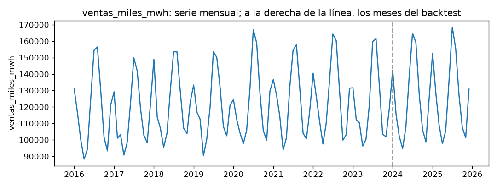
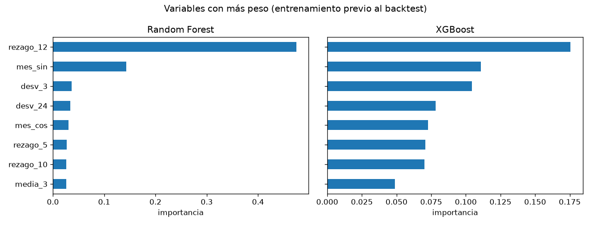
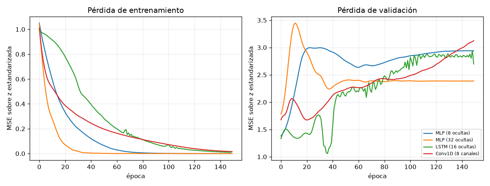
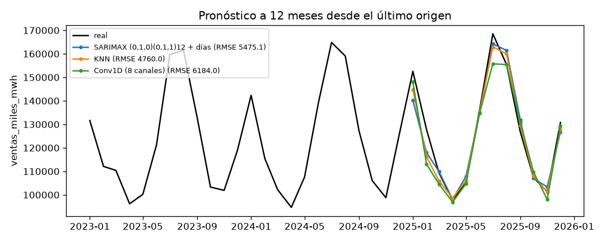

# Informe del miniproyecto 2

## 1. La serie y el modelo a superar

La serie mide las ventas mensuales de electricidad a clientes del sector
residencial de Estados Unidos, en **miles de MWh**. El CSV descargado trae 120
meses consecutivos, de 2016-01 a 2025-12, sin vacíos. Se conservan los valores
originales: las alertas por mes calendario del Miniproyecto 1 no mostraron
errores de registro, así que no se imputan ni se recortan observaciones. La
ficha completa está en `datos/README.md`.

La referencia clásica es la del Miniproyecto 1: SARIMAX
$(0,1,0)(0,1,1)_{12}$ con el número de días calendario de cada mes como
exógena, conocida de antemano. El índice de la exógena se extiende 12 meses
para cubrir el horizonte del último origen:

$$
(1-B)(1-B^{12})\,y_t=\beta\,\text{dias}_t+(1-\theta B^{12})\varepsilon_t,
\qquad \theta\approx 0{,}2767
$$

en el ajuste del Miniproyecto 1. En este *backtest* da RMSE 8300.63, MAE
6904.44 y MAPE 5.47 %, idénticos a los del miniproyecto anterior. El estacional
ingenuo da RMSE 6850.49, MAE 5686.72 y MAPE 4.49 %; es una referencia aún
más fuerte. El guion imprime la carga como `120 meses, de 2016-01 a 2025-12, 0
vacíos`. `comun.py` no se modificó.

## 2. La tabla supervisada

Cada fila corresponde a un mes que se quiere pronosticar. La tabla
contiene 21 predictores y el objetivo se guarda por separado.

| Grupo | Columnas | Cantidad | Qué representan |
|---|---|---:|---|
| Rezagos | `rezago_1` a `rezago_12` | 12 | Diferencias estacionales de los 12 meses anteriores. |
| Calendario | `mes`, `mes_sin`, `mes_cos` | 3 | Mes que se pronostica y su representación cíclica mediante seno y coseno. |
| Medias móviles | `media_3`, `media_12`, `media_24` | 3 | Promedios de la diferencia estacional en los 3, 12 y 24 meses anteriores. |
| Desviaciones estándar móviles | `desv_3`, `desv_12`, `desv_24` | 3 | Dispersión de la diferencia estacional en esas mismas ventanas. |
| **Total de predictores** | | **21** | |

El objetivo `dif12` es la diferencia entre las ventas de un mes y las
del mismo mes del año anterior:

$$
z_t = y_t - y_{t-12}
$$

Para la fila del mes $t$, el rezago $k$ es $z_{t-k}$. Las variables
`mes_sin` y `mes_cos` se calculan como el seno y el coseno de
$2\pi m_t/12$, donde $m_t$ es el número del mes.

Las medias y desviaciones móviles se calculan sobre `z.shift(1)`.
Por eso, la ventana de la fila $t$ termina en $t-1$. La prueba del
guion suma 1.000 al objetivo de cada fecha y comprueba que los
predictores de esa misma fila permanezcan iguales. El escalador se
ajusta con los datos de entrenamiento de cada origen.

El pronóstico es recursivo. Primero se crea la fila del mes siguiente
con sus predictores y se pronostica su diferencia estacional. Para
recuperar el nivel de ventas, se suma el valor de ese mismo mes
del año anterior:

$$
\hat{y}_t = y_{t-12} + \hat{z}_t
$$

El nivel pronosticado se incorpora a la serie para construir los
predictores del siguiente paso. El guion comprueba, por ejemplo, que
la fila de enero de 2026 usa como `rezago_1` la diferencia estacional
de diciembre de 2025 (5.284,95) y recupera el nivel con las ventas de
enero de 2025.

## 3. Aprendizaje automático

La validación temporal usa `TimeSeriesSplit(3)` sobre los primeros 96 meses;
2024 y 2025 no participan en la elección de hiperparámetros.

| Modelo | Rejilla | Elegido | RMSE validación |
|---|---|---|---:|
| KNN | `n_neighbors` 3, 5, 9 | 9 | 8936.30 |
| SVR | `C` 0.3, 1, 3; `epsilon` 0.05, 0.1 | `C=0.3`, `epsilon=0.05` | 8612.37 |
| Random Forest | `max_depth` 3, 6, None; `min_samples_leaf` 1, 3 | 3, 3 | 8466.92 |
| XGBoost | `max_depth` 2, 3, 4; `learning_rate` 0.05, 0.1 | 3, 0.05 | 9142.62 |

En Random Forest pesan `rezago_12` (0.474), `rezago_1` (0.143), `desv_24`
(0.036), `rezago_5` (0.034) y `media_12` (0.031). En XGBoost destacan
`rezago_12` (0.176), `mes_sin` (0.111), `desv_3` (0.104), `desv_24` (0.078) y
`mes_cos` (0.073). La PACF del Miniproyecto 1 marcaba los rezagos 1, 2 y 12;
por eso es coherente que el rezago 12 y el rezago 1 encabecen la importancia,
junto con la estacionalidad y la dispersión reciente.

| Modelo | RMSE | MAE | MAPE (%) |
|---|---:|---:|---:|
| KNN | 6296.25 | 5182.41 | 4.09 |
| SVR | 7442.70 | 5994.77 | 4.73 |
| Random Forest | 7213.29 | 5311.77 | 4.09 |
| XGBoost | 8051.96 | 5909.21 | 4.52 |

KNN gana entre los cuatro modelos de aprendizaje automático y también es el
mejor de los nueve en la nueva tabla.

## 4. Aprendizaje profundo

De las cuatro candidatas se conservó la MLP de menor pérdida de validación.
Las tres redes evaluadas en el *backtest* son:

| Red | Entrada | Arquitectura | Parámetros | Épocas |
|---|---|---|---:|---:|
| MLP (8 ocultas) | 21 columnas sueltas | `Linear(21,8)-ReLU-Linear(8,1)` | 185 | 1 |
| LSTM (16 ocultas) | secuencia `(lote,12,1)`, más viejo → más reciente | `LSTM(1,16)-Linear(16,1)` | 1233 | 37 |
| Conv1D (8 canales) | la misma secuencia de 12 rezagos | `Conv1d(1,8,k=3)-ReLU-Flatten-Linear(96,1)` | 129 | 21 |

La tercera red es una Conv1D pequeña: filtra localmente la secuencia de
rezagos con menos parámetros que la MLP y que la LSTM. Coincide con el código:
`Conv1DRed(8)` recibe `(lote,12,1)`, lo transpone a `(lote,1,12)` dentro de
`forward`, aplica `Conv1d(1,8,kernel_size=3,padding=1)`, ReLU, `Flatten` y
`Linear(8*12,1)`, es decir, 129 parámetros.

Las curvas muestran sobreajuste inmediato. La MLP de 8 ocultas alcanza su
mínimo de validación (1.379) ya en la época 1; en esa época la pérdida de
entrenamiento es 1.051 y en la época 150 cae a 0.000 mientras la de validación
sube a 2.940. La MLP de 32 ocultas también tiene su mínimo en la época 1
(1.782). La LSTM llega a 1.058 en la época 37 y la Conv1D a 1.673 en la época
21; en ambas la pérdida de entrenamiento sigue bajando hasta 0.015 y 0.016
mientras la de validación termina en 2.698 y 3.125. Por eso se usó una época
para la MLP, 37 para la LSTM y 21 para la Conv1D, y no las 150 completas.

La mejor red por RMSE fue **Conv1D (8 canales), 21 épocas**, con 6672.15.
Sus cinco semillas:

| Semilla | RMSE |
|---:|---:|
| 2026 | 6672.15 |
| 7 | 7069.65 |
| 13 | 6255.06 |
| 42 | 7923.24 |
| 123 | 5875.44 |
| **Media** | **6759.11** |
| **Desviación estándar** | **789.64** |

La variación entre semillas va de 5875.44 a 7923.24. Frente al SARIMAX
(8300.63), la Conv1D de la tabla gana por 1628.48 RMSE (19.6 %) y la media de
las cinco gana por 1541.52 (18.6 %): ambas diferencias superan la desviación
de 789.64 (2.1 y 2.0 veces). Frente al estacional ingenuo (6850.49), la Conv1D
de la tabla gana por 178.34 (2.6 %) y la media por 91.38 (1.3 %), márgenes
mucho más pequeños que la variación entre semillas.

## 5. La tabla y la elección

`resultados/metricas.csv`, ordenado por RMSE:

| Modelo | RMSE | MAE | MAPE (%) | Parámetros | Segundos |
|---|---:|---:|---:|---:|---:|
| KNN | 6296.25 | 5182.41 | 4.09 | 1512 | 9.9 |
| Conv1D (8 canales), 21 épocas | 6672.15 | 5434.12 | 4.30 | 129 | 9.0 |
| estacional ingenuo | 6850.49 | 5686.72 | 4.49 | 0 | 0.1 |
| Random Forest | 7213.29 | 5311.77 | 4.09 | 1234 | 17.5 |
| SVR | 7442.70 | 5994.77 | 4.73 | 1585 | 7.6 |
| MLP (8 ocultas), 1 épocas | 7563.09 | 6109.98 | 4.83 | 185 | 8.8 |
| XGBoost | 8051.96 | 5909.21 | 4.52 | 2356 | 13.6 |
| LSTM (16 ocultas), 37 épocas | 8270.40 | 6544.04 | 5.30 | 1233 | 11.9 |
| SARIMAX (0,1,0)(0,1,1)12 + días | 8300.63 | 6904.44 | 5.47 | 3 | 8.2 |

### Peor mes de cada modelo

Para cada origen $o$ y fecha objetivo $t$ se guardó el pronóstico y se calculó
$e_{o,t}=\lvert y_t-\hat y_{o,t}\rvert$. Luego se agruparon por fecha y se
promediaron sobre los orígenes que pronosticaron esa fecha:

$$
\bar e_t=\frac{1}{|O_t|}\sum_{o\in O_t}e_{o,t},
\qquad
t_{\text{peor}}=\arg\max_t\bar e_t .
$$

No se agrupa por mes civil ni por horizonte: cada fila es una fecha concreta.
Con 13 orígenes y horizonte 12, cada fecha de 2024-01 a 2025-12 recibe entre
1 y 12 pronósticos; el recuento aparece en la columna `origenes`. Los
pronósticos se obtuvieron con el mismo bucle de orígenes de `comun.backtest`,
replicado en `miniproyecto.py` sin tocar `comun.py`. Los archivos son
`resultados/errores_por_fecha.csv` y `resultados/peor_mes.csv`.

| Modelo | Peor mes | Error medio absoluto (miles de MWh) | Orígenes |
|---|---|---:|---:|
| Conv1D (8 canales), 21 épocas | 2025-02 | 13301.54 | 11 |
| KNN | 2024-06 | 12315.68 | 6 |
| LSTM (16 ocultas), 37 épocas | 2025-02 | 15647.30 | 11 |
| MLP (8 ocultas), 1 épocas | 2024-06 | 19729.94 | 6 |
| Random Forest | 2025-02 | 16027.71 | 11 |
| SARIMAX (0,1,0)(0,1,1)12 + días | 2024-01 | 16455.54 | 1 |
| SVR | 2024-06 | 18747.18 | 6 |
| XGBoost | 2024-06 | 17424.70 | 6 |
| estacional ingenuo | 2024-06 | 17600.85 | 6 |

El peor mes del SARIMAX, enero de 2024 con 16455.54 miles de MWh y un solo
origen, coincide con el error con signo reportado en el Miniproyecto 1. Después
de corregir el desfase del pronóstico recursivo, cinco modelos tienen su peor
mes en 2024-06: las ventas saltan de 107604.72 en mayo a 138920.46 en junio y
siguen a 164833.25 en julio. Conv1D, LSTM y Random Forest fallan más en
2025-02, cuando las ventas bajan de 152572.72 en enero a 127739.13 en febrero.

### Filas supervisadas y tamaño de las redes

El guion imprime `filas supervisadas: primer origen 60 de 96 meses; último
origen 72 de 108 meses`. En cada origen se pierden 12 meses al calcular
`dif12` y 24 más para completar la ventana móvil más larga, de 24 meses: por
eso quedan 60 filas con 96 meses de historia y 72 con 108. En el último origen
hay solo **72 filas** para ajustar 129 parámetros de la Conv1D, 185 de la MLP y
1233 de la LSTM; en el primero hay 60. KNN, con 9 vecinos y 21 columnas,
memoriza 1512 valores en el último origen.

Como posible explicación del sobreajuste está esa escasez de filas frente al
tamaño de las redes: la pérdida de entrenamiento sigue cayendo mientras la de
validación sube. En la MLP de 8 ocultas el entrenamiento pasa de 1.051 en la
época 1 a 0.000 en la 150, y la validación de 1.379 a 2.940; en la Conv1D,
de 0.387 a 0.016 y de 1.673 a 3.125; en la LSTM, de 0.445 a 0.015 y de 1.058
a 2.698. La LSTM, con 17 veces más parámetros que filas, queda incluso por
encima del SARIMAX.

## 6. Conclusión

La elección sale de la nueva tabla: pondría en uso **KNN**, con RMSE 6296.25,
MAE 5182.41 y MAPE 4.09 %, el mejor de los nueve modelos. El RMSE de KNN es
24,1 % menor que el del SARIMAX (6296.25 frente a 8300.63) y 8,1 % menor que
el del estacional ingenuo; es el único modelo que baja claramente de la línea
base simple. En CPU tarda 9.9 s en los 13 orígenes, frente a 8.2 s del SARIMAX
y 9.0 s de la Conv1D. El guion completo tarda 183 s. Necesita la tabla
supervisada: 60 filas en el primer origen y 72 en el último, con 96 y 108 meses
de historia respectivamente, y memoriza 1512 valores. El precio es la
explicabilidad: no hay una ecuación de coeficientes, sino un promedio uniforme
de los 9 vecinos más cercanos en el espacio estandarizado de 21 variables,
porque `KNeighborsRegressor` se construye sin el argumento `weights` y usa su
valor por defecto, `uniform`.

Mantendría el SARIMAX como respaldo auditable: 3 parámetros, exógena de días
calendario y una ecuación que se puede comunicar, aunque su RMSE sea 2004.38
más alto que el de KNN y quede por encima del estacional ingenuo. La Conv1D
también supera al clásico de forma estable entre semillas, y ahora supera a la
línea simple por un margen menor que su variación entre semillas. La decisión
es usar KNN para el pronóstico puntual, vigilar el peor mes de cada modelo y
conservar el SARIMAX cuando el pronóstico deba explicarse coeficiente a
coeficiente.
